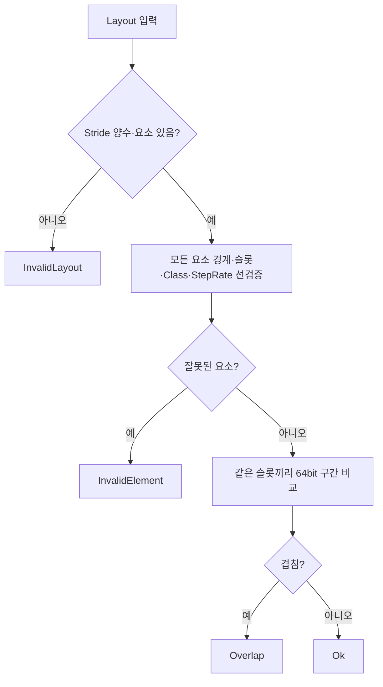

# 1. 정의 — 입력 요소 범위와 검증 순서
**InputLayout의 CPU 모델**은 인스턴싱 렌더링에서 각 입력 요소의 슬롯, 바이트 오프셋, 길이, 업데이트 간격을 검사하는 실습입니다. 실제 Direct3D11의 `ID3D11InputLayout` 구현 또는 CreateInputLayout 호출이 아닙니다. DX9의 FVF/VertexDeclaration을 기억한다면, D3D11에서는 `D3D11_INPUT_ELEMENT_DESC`와 정점/인스턴스 스트림의 분류를 분리해 생각하면 됩니다.
**반열린 구간** `[offset, offset+bytes)`를 사용해 동일 슬롯 요소 사이의 겹침을 판단합니다. 핵심은 *요소 전체의 경계를 먼저 검증한 뒤* 합과 비교를 수행하는 2-pass 방식입니다. 1-pass의 후속 요소 `b`를 검증하지 않은 상태로 `b.offset+b.bytes`를 먼저 더하면 `uint32_t` 래핑 때문에 오류 원인을 `InvalidElement`가 아닌 `Overlap`으로 잘못 분류할 수 있습니다. **Unsigned overflow는 C++에서 정의된 모듈러 연산**이며 이것 자체가 UB라는 뜻은 아닙니다.
# 2. 전제와 동작 원리
- 학습 전제: C++11 이상, 32비트 `uint32_t`와 64비트 `uint64_t`, `std::vector`, CMake 3.16 이상. `main.cpp`는 C++20과 C++11에서 동일하게 컴파일됩니다.
- 첫 단계: stride 양수/요소 목록 비어 있지 않은지 검사합니다. 모델의 슬롯은 0=vertex, 1=instance로 제한합니다.
- 둘째 단계: 각 요소의 `offset <= stride` 및 `bytes <= stride-offset`를 먼저 검사해 오버플로 없이 범위를 제한합니다. `perInstance`와 `stepRate`도 검증합니다.
- 셋째 단계: 같은 슬롯 요소에 한해 `uint64_t` 끝점을 구해 `a.start < b.end && b.start < a.end`이면 겹침으로 판단합니다. 빈 구간은 허용하지 않습니다.
- 주의: 학습 모델은 instance stepRate를 **정확히 1로 제한**하지만 실제 D3D11의 `InstanceDataStepRate`에는 1 외의 값도 존재합니다. 이 모델의 제한을 D3D11 API 전체 규칙으로 일반화하면 안 됩니다.

# 3. DX9 경험과 비교
<table fit-page-width="true" header-row="true">
<tr>
<td>구분</td>
<td>1-pass 사례</td>
<td>2-pass 개선</td>
</tr>
<tr>
<td>검사 순서</td>
<td>현재 요소 검사 도중 미검증 후속 요소와 교차 비교</td>
<td>전체 요소 경계·분류를 먼저 검사</td>
</tr>
<tr>
<td>정수 산술</td>
<td>32bit unsigned 덧셈이 래핑 가능</td>
<td>검증 뒤 64bit 끝점 계산</td>
</tr>
<tr>
<td>극단 반례</td>
<td>잘못된 뒤 요소를 Overlap으로 분류 가능</td>
<td>InvalidElement로 먼저 분류</td>
</tr>
<tr>
<td>게임 적용</td>
<td>버텍스/인스턴스 선언 오류 진단 불명확</td>
<td>에셋 로딩 시 잘못된 선언과 실제 겹침을 분리</td>
</tr>
</table>
# 4. 전체 실습 소스 · 테스트 증거
- **전체 ****`main.cpp`**** 5,681바이트:** <mention-page url="https://app.notion.com/p/3fda99703f408150bcb6ceb1602850a9"/>. SHA-256 `e8e0cab9c77fda85b0d7da6a08240b71334eb9e27a1a80679aea0695d4c54610`; FNV64 `ac4c8c2816989f9f`.
- **전체 ****`CMakeLists.txt`**** 681바이트·실제 빌드 명령:** <mention-page url="https://app.notion.com/p/3fda99703f4081cf9e53d91efafce3b1"/>. SHA-256 `699e52c8ebc0ab3dedb48554df11cffc97655568bf631cbe7c79326db574e126`.
- 실제 GCC14.2 C++20 <mention-page url="https://app.notion.com/p/3fda99703f4081fa822bf7fa2923c702"/>, GCC14.2 C++11 <mention-page url="https://app.notion.com/p/3fda99703f408135b96ac0a0bae7334b"/>, Clang17 C++20 ASan/UBSan <mention-page url="https://app.notion.com/p/3fda99703f408182b510f65f37811759"/>: 3환경 각각 Configure/Build/CTest 원시 stdout과 0바이트 stderr의 길이·FNV64 기록 보관. **각 CTest 1/1 PASS**, 동일 **고유 논리 조건 21개**를 반복 실행했으므로 독립 조건 63개라고 집계하지 않습니다.
- 극단 반례: stride=`UINT32_MAX`, 첫 요소 `offset=0,bytes=UINT32_MAX`, 뒤 요소 `offset=UINT32_MAX-2,bytes=10`. 기존 비교 분기에서는 `bytes+offset` 래핑에 의해 `Overlap`으로 분류되지만 전체 선검증 방식은 `InvalidElement`를 정확히 반환합니다.
- 이 실습은 CPU-only 모델. Windows/MSVC·실제 D3D11/HLSL 컴파일·GPU InputLayout·Unity Editor는 이번에 **실행하지 않아 미검증**입니다. `-fsanitize=address,undefined`가 산술 오류 분류의 논리적 정확성을 대신하지도 않습니다.
# 5. 게임 개발 적용과 실수
정적 메시/인스턴스 렌더링 데이터 로딩 앞단의 **입력 레이아웃 계약 검사**, 잘못된 메타데이터의 진단, 렌더러 초기화 전 CPU 테스트에 활용합니다. 이것은 `IASetVertexBuffers`, `CreateInputLayout` 또는 실제 셰이더 시그니처의 유효성을 확인하지 않습니다. 입력 슬롯·시맨틱·DXGI_FORMAT의 실제 제한은 API 문서와 GPU 실측으로 별도 점검해야 합니다.
# 6. 접힌 이해 확인

Q1. `unsigned` 덧셈이 wrap되면 항상 Undefined Behavior인가요?

	아닙니다. unsigned 산술은 범위의 모듈러 연산으로 정의됩니다. 다만 래핑된 값으로 구간 겹침을 검사하면 논리 결과가 잘못될 수 있습니다.

Q2. 다른 슬롯의 요소 범위가 겹쳐도 Overlap인가요?

	아닙니다. 이 모델에서는 서로 다른 Vertex Buffer 스트림의 구간이므로 동일 슬롯에 대해서만 겹침을 비교합니다.

Q3. D3D11의 InstanceDataStepRate는 반드시 1인가요?

	아닙니다. 여기서는 간단한 모델을 위해 1로 제한했을 뿐이며 실제 API는 다른 인스턴스 증가 간격을 허용합니다. per-vertex 요소는 0이어야 합니다.

# 7. 공식 출처·변경 내역
- [Microsoft: D3D11_INPUT_ELEMENT_DESC](https://learn.microsoft.com/en-us/windows/win32/api/d3d11/ns-d3d11-d3d11_input_element_desc) — InputSlot, AlignedByteOffset, InputSlotClass, InstanceDataStepRate 정의.
- [Microsoft: D3D11_MAP](https://learn.microsoft.com/en-us/windows/win32/api/d3d11/ne-d3d11-d3d11_map) — WRITE_DISCARD/NO_OVERWRITE는 별도 동적 버퍼 관리 계약.
- 원래 13A 보존 문서는 <mention-page url="https://app.notion.com/p/3fba99703f40810b826cc7eec5b1f039">13A · Instancing CPU 구현·검증 색인과 전체 소스 보관</mention-page>. 이 실습은 기존 13A 코드를 수정하지 않는 독립 보완본이며 **역사적 main.cpp SHA-256 불일치를 해결했다고 주장하지 않습니다.**
- <mention-date start="2026-10-19"/> v1.0: 극단 오프셋 경계·검증 순서 반례를 재현하는 전체 CPU-only C++11/20 모델과 CMake, 3환경 원시 CTest 로그를 저장했습니다.
