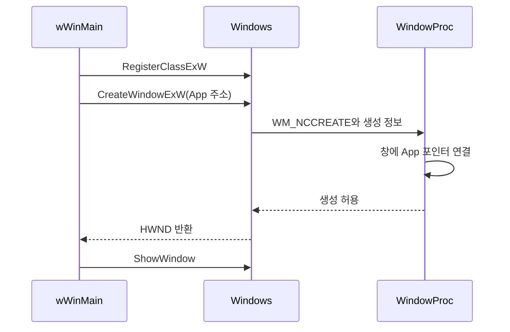

<callout icon="🪟" color="blue_bg">
	**창, 프로세스, 모듈, 메시지 큐를 구분하는 것이 WinAPI의 출발점입니다.**
	<mention-date start="2026-10-13"/> · 관련 파일 `windows/winapi_demo.cpp` · Windows 전용 코드는 컴파일·실행 미검증
</callout>
<mention-page url="https://app.notion.com/p/fffca9a4ce864ac7bade7efe90186be7">WinAPI 게임 프로그래밍 — 개정판 v1.0</mention-page>
<table_of_contents color="gray"/>
## 1. HWND는 프로세스 번호가 아닙니다
프로세스에는 여러 스레드와 여러 창이 있을 수 있습니다. HWND는 **창을 식별하는 핸들**이며 프로세스 ID가 아닙니다. HINSTANCE는 로드된 모듈의 인스턴스를 식별하는 데 쓰고, HDC는 그리기용 장치 컨텍스트 핸들입니다. 생긴 모양이 정수나 포인터처럼 보인다고 서로 바꿔 해석하지 않습니다.
<table fit-page-width="true" header-row="true">
<tr>
<td>이름</td>
<td>역할</td>
<td>혼동하면 안 되는 것</td>
</tr>
<tr>
<td>HWND</td>
<td>창을 식별</td>
<td>프로세스 ID, C++ 창 객체 주소</td>
</tr>
<tr>
<td>HINSTANCE</td>
<td>모듈 인스턴스와 리소스 접근에 사용</td>
<td>부모 창</td>
</tr>
<tr>
<td>HDC</td>
<td>GDI 그리기 상태와 출력 대상</td>
<td>동적 라이브러리</td>
</tr>
<tr>
<td>HANDLE</td>
<td>API별 커널 객체 등의 핸들</td>
<td>모든 핸들의 수명·해제 방식이 같다는 가정</td>
</tr>
</table>
획득한 핸들은 그 API가 정한 종료 방법을 사용해야 합니다. HWND에 CloseHandle을 호출하거나 HDC를 임의 캐스팅해 비트맵으로 취급하지 않습니다. [Microsoft — 창 생성과 HWND](https://learn.microsoft.com/en-us/windows/win32/learnwin32/creating-a-window).
## 2. wWinMain의 인수를 정확히 읽습니다
```c++
int WINAPI wWinMain(HINSTANCE instance,
                   HINSTANCE previousInstance,
                   PWSTR commandLine,
                   int showCommand);
```
instance는 현재 모듈, previousInstance는 현대 Win32에서 의미 없이 0인 옛 인수, commandLine은 명령행, showCommand는 창 표시 상태입니다. previousInstance를 부모 창으로, showCommand를 인스턴스 번호로 설명한 기존 메모를 교정합니다.
이 예제는 Unicode의 W 계열 함수를 명시적으로 사용합니다. WCHAR/Windows UTF-16 코드 단위와 사용자가 보는 글자 하나를 동일시하지 않습니다. CRT 초기화가 필요한 C++ 프로그램에서는 임의로 엔트리 포인트를 바꾸어 초기화 과정을 건너뛰지 않습니다.
[Microsoft — WinMain 진입점](https://learn.microsoft.com/en-us/windows/win32/learnwin32/winmain--the-application-entry-point).
## 3. 등록과 생성, 메시지는 서로 이어져 있습니다
창 클래스 등록은 스타일·콜백·커서 등 공통 동작을 알려주는 과정입니다. 실제 창은 CreateWindowExW로 생성합니다. 등록 정보가 hInstance라는 변수 안에 저장된다는 뜻은 아닙니다.
CreateWindowExW는 반환하기 전에 생성 관련 메시지를 호출할 수 있습니다. 그래서 전역 HWND에 값을 대입한 다음에야 모든 콜백이 시작될 것이라고 가정하면 안 됩니다. 예제는 생성 인수에 App 포인터를 넘기고, WM_NCCREATE에서 `CREATESTRUCTW::lpCreateParams`로 받아 GWLP_USERDATA에 연결합니다.

상태 포인터는 `SetWindowLongPtrW`와 LONG_PTR로 저장하여 포인터 폭을 보존합니다. 64비트 포인터를 LONG으로 줄이지 않습니다. 해당 함수의 반환 0은 이전 값이 0이었다는 성공일 수도 있으므로 예제는 SetLastError(0)와 GetLastError를 함께 확인합니다. 이 방법도 실제 포인터의 수명을 연장해 주지는 않습니다.
[Microsoft — SetWindowLongPtrW](https://learn.microsoft.com/en-us/windows/win32/api/winuser/nf-winuser-setwindowlongptrw).
## 4. 메시지 인수의 뜻은 메시지마다 다릅니다
```c++
LRESULT CALLBACK WindowProc(HWND window, UINT message,
                            WPARAM wParam, LPARAM lParam);
```
wParam은 키보드, lParam은 마우스라는 고정 분류가 아닙니다. 메시지마다 코드·플래그·크기·포인터 등 서로 다른 의미가 있습니다. WM_SIZE, WM_KEYDOWN, WM_DPICHANGED의 인수를 같은 방식으로 해석해서는 안 됩니다.
처리하지 않는 메시지는 보통 DefWindowProcW에 전달해 기본 동작을 유지합니다. 생성·파괴 메시지에서의 반환값도 계약대로 처리합니다. C++ 예외가 OS 콜백 바깥으로 전파되지 않도록 예제의 콜백 경계에서 잡아 오류 상태를 기록하고 종료합니다.
## 5. GetMessage는 세 가지 결과가 있습니다
GetMessage의 반환형이 BOOL이라고 성공/실패 두 가지만 있다고 생각하면 안 됩니다. 양수는 메시지, 0은 WM_QUIT, −1은 오류입니다.
```c++
MSG message{};
for (;;) {
    const BOOL result = GetMessageW(&message, nullptr, 0, 0);
    if (result == -1) {
        // 오류를 기록하고 종료합니다.
        break;
    }
    if (result == 0) break;
    TranslateMessage(&message);
    DispatchMessageW(&message);
}
```
이것은 이벤트 중심 루프의 설명 코드입니다. 실습 GUI는 연속 갱신을 위해 다음 문서의 PeekMessage 기반 루프를 사용합니다. GetMessage가 메시지를 기다리는 것과 CPU를 소모하며 조건을 반복 검사하는 것은 다른 동작입니다.
PeekMessage는 즉시 반환하며, 현재 메시지를 얻었는지 확인합니다. PM_REMOVE로 얻은 메시지를 큐에서 제거하고 처리합니다. 메시지 검색 중에도 전달된 메시지 처리가 일어날 수 있으므로 메시지 펌프를 아무 사용자 코드도 실행하지 않는 단순 배열 조회로 생각하지 않습니다.
근거: [GetMessageW](https://learn.microsoft.com/en-us/windows/win32/api/winuser/nf-winuser-getmessagew), [PeekMessageW](https://learn.microsoft.com/en-us/windows/win32/api/winuser/nf-winuser-peekmessagew).
## 6. 번역, 전달, 종료를 구분합니다
TranslateMessage는 가상 키 메시지에서 문자 메시지를 생성하는 데 사용합니다. 단축키 테이블을 처리하는 TranslateAccelerator와 다릅니다. DispatchMessage는 해당 메시지를 창 프로시저로 전달하는 경로입니다. [TranslateMessage 공식 문서](https://learn.microsoft.com/en-us/windows/win32/api/winuser/nf-winuser-translatemessage).
WM_CLOSE는 창 닫기 요청이고, DestroyWindow는 창 파괴를 시작합니다. 실습은 주 창의 WM_DESTROY에서 PostQuitMessage를 호출합니다. **WM_QUIT는 스레드 메시지 루프의 종료 신호**이며 일반 창 메시지처럼 WndProc의 case에서 받으려 하지 않습니다. 여러 창이 있다면 아무 보조 창이나 닫았다고 앱 전체를 종료하지 않도록 정책이 필요합니다.
WM_NCDESTROY에서는 예제가 연결한 App 포인터를 분리합니다. App은 창보다 오래 살아 있어야 하므로 wWinMain의 지역 객체로 유지하고 종료 시 남은 창을 먼저 파괴합니다. C++ 객체를 해제한 뒤 OS가 그 포인터로 콜백하지 않게 하는 순서입니다.
## 7. x86 호출 규약을 모든 환경으로 일반화하지 않습니다
x86의 cdecl/stdcall 설명에는 스택 인수 정리 주체와 이름 장식 차이가 등장합니다. 이는 특정 ABI 규칙입니다. MSVC x64는 앞쪽 정수 인수를 RCX·RDX·R8·R9 등에 전달하는 별도 규약을 사용합니다. x86에서 외운 ‘전부 오른쪽부터 스택에 넣음’을 x64 코드에 그대로 적용하지 않습니다.
실무에서는 CALLBACK/WINAPI가 요구되는 시그니처를 그대로 맞추고, 함수 포인터 캐스팅으로 다른 호출 규약을 숨기지 않습니다. 언어의 인수 평가 순서와 ABI의 인수 전달 위치도 다른 문제입니다. [Microsoft — x64 호출 규약](https://learn.microsoft.com/en-us/cpp/build/x64-calling-convention?view=msvc-170).
## 8. 확인 질문과 검증 범위
<details>
<summary>같은 프로세스에서 두 창을 만들면 HWND도 같은가?</summary>
	아닙니다. 서로 다른 창은 각각 식별되어야 합니다. 모듈 인스턴스를 공유할 수 있다는 사실과 창 핸들이 같다는 것은 다른 말입니다.
</details>
<details>
<summary>while(GetMessage(...))가 간단한데 왜 그대로 쓰지 않는가?</summary>
	−1도 C++ 조건식에서는 참이므로 오류를 정상 메시지처럼 처리할 수 있습니다. 양수·0·−1을 분리합니다.
</details>
본문은 공식 계약과 새 예제의 정적 검토에 기반합니다. 이번 실행 환경에서 wWinMain, 창 생성, 메시지 콜백의 실제 Windows 동작을 테스트하지 않았습니다.
