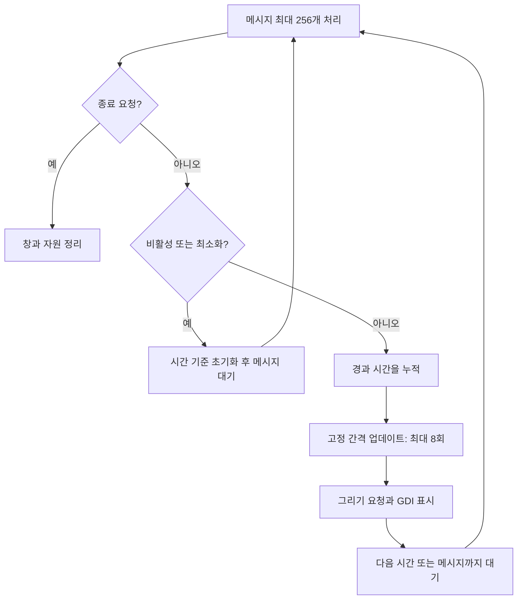

<callout icon="⏱️" color="blue_bg">
	**메시지 처리 빈도, 시뮬레이션 시간, 렌더링 횟수는 같은 것이 아닙니다.**
	C++20 · <mention-date start="2026-10-13"/> · 공통 실습 `include/loop.hpp`, `src/loop_input.cpp`
</callout>
<mention-page url="https://app.notion.com/p/fffca9a4ce864ac7bade7efe90186be7">WinAPI 게임 프로그래밍 — 개정판 v1.0</mention-page>
<table_of_contents color="gray"/>
## 1. 게임 갱신과 OS 메시지 처리를 둘 다 진행합니다
메시지가 없을 때만 게임을 갱신하면 메시지가 계속 들어오는 상황에서 업데이트가 굶을 수 있습니다. 반대로 메시지를 처리하지 않고 Update/Render만 반복하면 창이 응답하지 않습니다. 실습 GUI는 메시지를 한 번에 최대 256개 처리한 뒤 게임 갱신 기회를 줍니다. 이 숫자는 공정성을 위한 실습 정책이지 Windows의 제한이 아닙니다.
PeekMessage를 쓴다고 WM_PAINT·WM_SIZE·키 입력을 못 받게 되는 것은 아닙니다. 메시지를 얻어 TranslateMessage/DispatchMessage로 전달하는 흐름을 유지합니다. 이벤트 중심 편집기는 GetMessage 기반 구조도 적합할 수 있고, 계속 갱신하는 게임은 타이밍과 대기를 함께 설계합니다.

## 2. QPC의 값은 초가 아닙니다
QueryPerformanceCounter는 카운터 값, QueryPerformanceFrequency는 초당 카운터 단위를 제공합니다. 경과 초는 다음처럼 계산합니다.
$$
\Delta t=\frac{counter_{now}-counter_{previous}}{frequency}
$$
정수 나눗셈이 되지 않도록 double 등으로 계산합니다. frequency는 초기화 때 얻어 보관하며, 실패도 처리합니다. ‘하드웨어 시간이 항상 백만분의 1초’라는 고정 단위 설명은 잘못입니다. 실제 frequency와 사용 목적을 확인해야 합니다. QPC는 이 예제에서 경과 간격을 측정하는 도구이며 날짜·UTC 시각을 대신하지 않습니다.
[Microsoft — 고해상도 시간 측정](https://learn.microsoft.com/en-us/windows/win32/sysinfo/acquiring-high-resolution-time-stamps), [QueryPerformanceCounter](https://learn.microsoft.com/en-us/windows/win32/api/profileapi/nf-profileapi-queryperformancecounter).
## 3. 고정 시간 단계와 과도한 누적을 처리합니다
공통 `FixedStepper`는 120Hz, 즉 h=1/120초로 Update를 호출합니다. 렌더링 한 번 사이에 시간이 많이 지났으면 여러 번 갱신하고, 아직 h만큼 모이지 않았으면 갱신 없이 남은 시간을 보존합니다.
실습 정책은 한 프레임 입력 시간을 최대 0.25초로 제한하고, 한 바깥 루프에서 업데이트를 최대 8회 수행합니다. 그래도 남은 완전한 시간 단계는 버리고 나머지를 유지합니다. 이로 인해 멈췄다가 돌아오는 동안 시뮬레이션 시간이 실제 시간보다 적게 흐를 수 있습니다. 로컬 학습 앱이 끝없이 따라잡는 상황을 피하기 위한 선택이며 네트워크 동기화·리플레이 결정성을 보장하지 않습니다.
반환한 alpha는 남은 누적 시간/h입니다. 이전·현재 상태를 보간하는 데 사용할 수 있지만, 이번 GDI 데모는 현재 상태를 직접 그리며 보간 렌더링을 구현하지 않았습니다.
참고: [Glenn Fiedler — Fix Your Timestep](https://gafferongames.com/post/fix_your_timestep/). 구체적인 120Hz·8회·0.25초 값은 이 실습에서 정한 값입니다.
## 4. 키의 눌림 상태와 눌린 순간을 구분합니다
이동은 키가 눌려 있는 held 상태가 필요하고, 점프·발사는 한 번 눌린 순간 pressed가 필요합니다. Windows 키 반복 메시지마다 새 발사를 발생시키면 키보드 반복 설정이 게임 규칙을 바꾸게 됩니다.
실습 `Input`은 false→true일 때만 pressed를 기록합니다. 여러 업데이트가 한 프레임에 실행되더라도 `ConsumePressed`가 한 번만 소비합니다. 업데이트가 없는 짧은 프레임에서 입력을 받았다면 다음 갱신까지 보관합니다. 눌렀다가 떼는 메시지가 갱신 사이에 모두 들어와도 눌린 순간은 남깁니다. 같은 키의 여러 번 빠른 누름 횟수는 bool 하나로 합쳐지므로 리듬게임처럼 모든 에지를 보존해야 할 때는 이벤트 큐가 필요합니다.
포커스를 잃으면 held와 pressed를 비웁니다. 앱 밖에서 키를 놓았을 때 key-up이 오지 않아 계속 이동하는 문제를 막기 위한 기본 정책입니다. GetAsyncKeyState를 쓰는 기존 코드는 상위 비트의 현재 상태와 하위 비트를 구분합니다. 하위 비트의 ‘이전 호출 이후 눌림’에 안정적인 단발 입력 처리를 의존하지 않습니다. [GetAsyncKeyState](https://learn.microsoft.com/en-us/windows/win32/api/winuser/nf-winuser-getasynckeystate).
## 5. 정지·복귀와 프레임 대기
최소화, 비활성화, 창 크기 조정 중에는 실습의 시뮬레이션을 멈춥니다. 복귀 때 이전 카운터와 누적 시간을 재설정하여 창을 끌던 수 초를 갑자기 게임에 적용하지 않습니다. 이런 정책은 모든 게임의 정답이 아니며 온라인 게임은 연결·백그라운드 처리 요구에 맞춰야 합니다.
빈 반복으로 시간을 기다리지 않고 MsgWaitForMultipleObjectsEx로 메시지나 시간 경과를 기다립니다. MWMO_INPUTAVAILABLE은 이미 큐에 남아 있는 입력도 대기 조건으로 고려하게 하는 옵션입니다. 대기 실패도 처리합니다. [공식 대기 함수 계약](https://learn.microsoft.com/en-us/windows/win32/api/winuser/nf-winuser-msgwaitformultipleobjectsex).
밀리초 timeout이 정확한 화면 주사율을 보장하지는 않습니다. 이 GDI 예제는 Present 기반 수직 동기화가 없고, Sleep(1)을 쓰거나 QPC를 쓴다는 이유만으로 정확히 120FPS가 되는 것도 아닙니다. 120Hz는 Update의 시간 간격입니다.
## 6. 논리 단위와 물리 픽셀을 명시합니다
실습 Win32 데모의 상태 좌표는 x 오른쪽·y 아래쪽의 논리 단위입니다. 표시할 때 DPI/96을 곱하고 클릭 입력에는 그 역을 적용합니다. 게임 수학의 Camera2D 예제는 y 위쪽 월드를 화면으로 바꾸는 별도 규약이므로 그대로 혼용하지 않습니다.
마우스 클라이언트 좌표는 GET_X_LPARAM/GET_Y_LPARAM처럼 부호를 보존하는 방법으로 읽습니다. 화면 좌표를 얻는 API를 썼다면 먼저 해당 창의 클라이언트 좌표로 바꿉니다. 윈도우 전체 크기와 그릴 수 있는 클라이언트 크기도 구분합니다.
예제는 manifest로 PerMonitorV2를 요청하고 WM_DPICHANGED에서 권장 사각형을 적용합니다. 새 DPI와 클라이언트 크기를 기반으로 버퍼와 좌표를 갱신합니다. 도형과 입력의 스케일은 구현했지만, 기본 GUI 폰트를 대체하는 정교한 DPI별 글꼴·텍스트 레이아웃까지 구현하지는 않았습니다.
근거: [GetDpiForWindow](https://learn.microsoft.com/en-us/windows/win32/api/winuser/nf-winuser-getdpiforwindow), [WM_DPICHANGED](https://learn.microsoft.com/en-us/windows/win32/hidpi/wm-dpichanged), [manifest를 통한 DPI 설정 권고](https://learn.microsoft.com/en-us/windows/win32/api/winuser/nf-winuser-setprocessdpiawarenesscontext).
## 7. 검증과 질문
`loop_input`의 484회 조건 검사에서 시간 단계 누적, 과부하 시 상한·시간 버림, 반복 키 입력의 한 번 소비, 포커스 초기화, 애니메이션 나머지 시간 보존을 확인했습니다. GCC·Clang·ASan/UBSan에서 통과했습니다. 실제 키보드 이벤트, 모니터 간 DPI 이동, Windows 대기 함수의 동작은 실행 미검증입니다.

한 프레임에 Update가 4번 호출되면 Space도 4번 처리해야 할까?

	현재 눌린 상태와 눌린 순간을 구분합니다. 단발 동작은 소비된 에지를 다시 쓰지 않습니다. 특정 입력을 모든 하위 단계에 적용할지 한 번만 적용할지는 게임 행동별 계약입니다.

프레임이 1초 멈췄는데 최대 8회만 갱신하면 시간이 정확하지 않지 않을까?

	맞습니다. 이 실습은 과도한 따라잡기를 막기 위해 시간을 버립니다. 정확한 실제 시간 진행이 중요한 작업에는 다른 정책이 필요하며 이 제한을 몰래 적용하면 안 됩니다.

