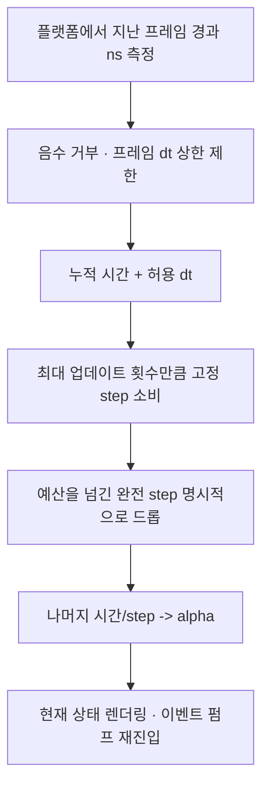

<callout icon="🧪" color="blue_bg">
	**WinAPI 04A · 고정 시간 단계와 프레임 드롭의 CPU 계약**. C++/DX9 프로그래밍의 `Update(dt)`를 Windows 메시지 루프와 연결하기 전, 입력된 경과 시간의 일부를 버리는 정책까지 독립적으로 검증합니다. 이 실습은 **Win32·MFC·GPU를 실행하지 않는 이식 가능한 CPU 프로그램**입니다.
</callout>
## 정의·전제
**고정 시간 단계(fixed timestep)**는 실제 프레임 간격과 별개로 게임 시뮬레이션 `Update`에 일정한 간격 `step`을 여러 번 적용하는 정책입니다. 메시지 펌프는 OS 이벤트를 처리하고, 타이머는 경과 시간을 제공하며, 렌더링은 시뮬레이션 완료 뒤 수행할 수 있습니다. `QueryPerformanceCounter`처럼 단조 증가를 기대하는 고해상도 시간원을 Windows에서 선택하더라도, 프레임과 업데이트를 혼동하면 안 됩니다.
- 전제: `step_ns>0`, `max_frame_ns>=step_ns`, `max_updates>0`. 합산이 signed 64비트 범위를 넘지 않도록 생성자에서 제한합니다. `tick`은 음수 시간을 거부합니다.
- 선택한 **교육용 정책**: 한 프레임의 큰 `dt`는 `max_frame_ns`로 먼저 제한하고, `max_updates` 횟수 이후 남은 **완전한 step**을 버리며 분수 나머지만 보존합니다. 실제 시간이 보존되는 시뮬레이션은 아닙니다.
## 작동 원리

<table header-row="true">
<tr>
<td>방법</td>
<td>장점</td>
<td>주의할 점</td>
</tr>
<tr>
<td>가변 dt 1회</td>
<td>구현 단순</td>
<td>프레임별 dt 변화가 물리 안정성에 영향</td>
</tr>
<tr>
<td>무제한 고정 step</td>
<td>모든 누적 step 처리</td>
<td>과부하 때 따라잡기 루프가 영구 지연 가능</td>
</tr>
<tr>
<td>예산 제한 고정 step (이 실습)</td>
<td>CPU 작업량을 프레임별 제한</td>
<td>과도한 경과 시간은 의도적으로 버려 게임 시간이 느려질 수 있음</td>
</tr>
</table>
## 전체 C++11/20 소스·빌드
`main.cpp` 전문은 <mention-page url="https://app.notion.com/p/3fda99703f4081ec9047dd6279a8a20d"/> 2,450B와 <mention-page url="https://app.notion.com/p/3fda99703f40813cb563f196516f849a"/> 2,251B를 **추가 문자 없이 순서대로 연결**하면 됩니다. 합계 4,701B, FNV64 `b51d90ade18fcc1e`, SHA-256 `5e711d0e1b1685cca876e94c3416dde0e4271c3bb4e9e959fc292f2d7dde15d2`. `CMakeLists.txt` 543B <mention-page url="https://app.notion.com/p/3fda99703f4081b78842ea8ee31a51d2"/>; FNV64 `7bf11d85adb99365`.
```shell
cmake -S . -B build -DLAB_CXX_STANDARD=20 -DCMAKE_BUILD_TYPE=Debug
cmake --build build
ctest --test-dir build -V --output-on-failure
```
C++11 빌드는 `-DLAB_CXX_STANDARD=11` 지정. Clang ASan/UBSan에는 `-DCMAKE_CXX_COMPILER=clang++ -DCMAKE_CXX_FLAGS="-fsanitize=address,undefined -fno-omit-frame-pointer"`를 사용했습니다.
## 반례와 게임 개발 적용
큰 `dt`를 다 처리하면 `Update`의 과도한 반복으로 입력·그리기를 지연시킬 수 있습니다. 이 예제는 `tick(55)`, step=10, frameClamp=30, updateBudget=2에서 **2회 업데이트, 35ns 드롭, 나머지 0**을 검증합니다. 분수 나머지 6+7ns는 1회 업데이트와 3ns 나머지로 이어집니다. 실제 게임에서는 삭제된 시간 때문에 네트워크 타임스탬프·리플레이·서버 권위 시뮬레이션과 충돌할 수 있으므로 정책을 구분합니다.
## 실제 CPU 검증·현재 로그 보관 상태
2026-10-19 GCC 14.2 C++20·C++11, Clang 17 C++20 ASan/UBSan 세 환경에서 각각 **CTest 1/1**, 같은 **23개 논리 조건** 통과. 23×3을 고유 69개로 계수하지 않습니다. CTest의 실제 실행 결과를 재현 가능한 전체 코드와 분리해서 읽습니다. 원시 GCC20의 Configure/Build 기록 <mention-page url="https://app.notion.com/p/3fda99703f40817e9f52ce6ca9e697cb"/>·CTest <mention-page url="https://app.notion.com/p/3fda99703f40815594aaecbee624132e"/>, GCC11 Configure/Build <mention-page url="https://app.notion.com/p/3fda99703f408178a476c6de0429fe3f"/>은 저장됨. **2026-10-19 후속 로그 복구 완료:** GCC11 CTest <mention-page url="https://app.notion.com/p/3fda99703f408147a607ecca81d73f6d">Win04A GCC C++11 23검사 CTest 원시 로그</mention-page>, ClangSan Configure·Build <mention-page url="https://app.notion.com/p/3fda99703f408198aa5af67fd25b9bc9">Win04A clangsan 실제 Configure·Build 원시 422B+145B</mention-page>·CTest <mention-page url="https://app.notion.com/p/3fda99703f4081348fa3fe87f088a230">Win04A Clang17 ASan/UBSan 23검사 CTest 원시 로그</mention-page>를 Notion에 저장했습니다. 3환경 Configure·Build·CTest stdout 총 **9/9개**의 코드 본문·끝·바이트 길이·FNV64 및 부모를 fetch로 검증했습니다. 해당 단계의 stderr는 모두 0바이트이며 그 사실과 빈 SHA-256을 로그 기록에 명시했습니다. **Win04A CPU 모델의 코드·CMake·원시 로그 보관은 완료**, 단 원시 첨부 ZIP 바이너리 재다운로드와 Windows/MSVC·WinAPI GUI 실행은 여전히 미검증. Windows/MSVC·Win32 GUI·QPC 실측은 미검증.
<details>
<summary>Q1. 고정 step은 실제 시간이 반드시 빠짐없이 흐르게 할까요?</summary>
	아닙니다. 이 모델의 clamp와 update budget은 전체 step을 명시적으로 버리는 정책입니다. 손실된 시간을 `dropped_ns`로 기록합니다.
</details>
<details>
<summary>Q2. alpha가 0.6이면 시뮬레이션을 0.6 step 더 실행했나요?</summary>
	아닙니다. 전체 step을 채우지 않은 잔여 시간 비율을 반환한 것이며, 렌더링 보간에 사용할 수 있습니다.
</details>
<details>
<summary>Q3. Clang ASan/UBSan 통과가 WinAPI 창 생성의 안전성을 보장하나요?</summary>
	아닙니다. 이 테스트에 WinAPI 호출 자체가 없으며 sanitizer 통과는 모든 논리 오류·경합·플랫폼 차이를 증명하지 않습니다.
</details>
## 공식 출처·변경 이력
- [QueryPerformanceCounter](https://learn.microsoft.com/en-us/windows/win32/api/profileapi/nf-profileapi-queryperformancecounter)
- [PeekMessageW](https://learn.microsoft.com/en-us/windows/win32/api/winuser/nf-winuser-peekmessagew)
- [Clang AddressSanitizer](https://clang.llvm.org/docs/AddressSanitizer.html)
- <mention-date start="2026-10-19"/> v1.0: 이전 WinAPI 04 통합 실습의 시간 처리 구간을 **순수 CPU 고정 단계 정책**으로 분리, 엣지 케이스 23개를 Linux에서 실측. 원본 WinAPI 04 내용과 기존 하위 문서는 교체하지 않음. 최초 작성 시점에는 원시 로그 일부 미보관으로 완료 판정 보류. 같은 날 후속으로 Configure·Build·CTest stdout 9/9개를 저장·재조회하여 CPU 교재의 텍스트 보관은 완료했습니다(첨부 ZIP 재다운로드·Windows GUI 실행은 미검증).
<page url="https://app.notion.com/p/3fda99703f408198aa5af67fd25b9bc9">Win04A clangsan 실제 Configure·Build 원시 422B+145B</page>
<page url="https://app.notion.com/p/3fda99703f408147a607ecca81d73f6d">Win04A GCC C++11 23검사 CTest 원시 로그</page>
<page url="https://app.notion.com/p/3fda99703f4081348fa3fe87f088a230">Win04A Clang17 ASan/UBSan 23검사 CTest 원시 로그</page>
